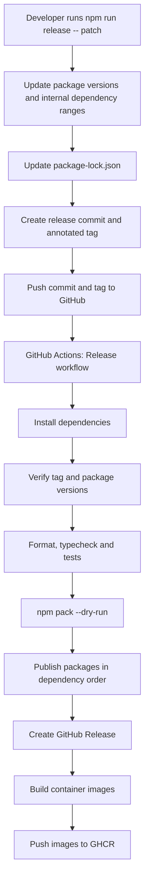

# OPS-1 - Draw the release

## Purpose

This document describes how a release moves from a local version update to package publication on npm and container image publication on GitHub Container Registry (GHCR).

The release process is tag-driven: a Git tag identifies the release, GitHub Actions validates the repository state, and CI handles publication.

## Release flow

## Publication targets

- **npm:** publishes the repository packages in dependency order.

- **GitHub Releases:** creates a release associated with the Git tag.

- **GHCR:** stores the container images for the agent runtime and sandbox.

The image job depends on the successful completion of the package publication job. A failure during image building does not undo packages already published to npm.

## Failure scenarios

### 1. Tag and package version mismatch

**Cause:** The Git tag version does not match the version declared in every package manifest.

**Impact:** The verification step fails and the workflow stops before package publication.

**Recovery:** Correct the version inconsistency and create a valid release tag following the repository release procedure.

### 2. npm publication failure

**Cause:** A package cannot be published, for example because of an authentication problem or because a package has not been bootstrapped on npm.

**Impact:** The release may be partially published. Packages published before the failure remain available, while subsequent packages are not processed.

**Recovery:** Resolve the publication issue and rerun the workflow using the same tag. The workflow checks whether each package version already exists and skips packages that have already been published.

### 3. Container image build failure

**Cause:** The Docker image build or push to GitHub Container Registry fails.

**Impact:** Packages already published to npm remain available, but the affected image is not published to GHCR.

**Recovery:** Investigate and fix the image build or push issue, then rerun the image workflow. The product can also build the required images locally, although this may take longer.

### Observable evidence

| Failure scenario | Evidence to look for |

|---|---|

| Tag and package version mismatch | The verification step fails in the Release workflow. The publication step is not reached. |

| npm publication failure | The workflow log shows the npm publication error. Packages published before the failure remain available. On rerun, already published versions are skipped. |

| Container image build failure | The image job reports a build or push error. The npm publication job remains successful, and published packages are not rolled back. |

These are expected observations based on the workflow implementation. They were not artificially triggered during this challenge.

## Local execution finding

During local validation on Windows, the release script failed when attempting to invoke npm:

`Error: spawnSync npm ENOENT`

The script had already updated the package manifests before failing to refresh the lockfile. This left the working tree modified without completing the release commit or creating a tag.

The package manifests were restored with `git restore`, and the working tree was checked afterward.

This observation shows that the script's direct `npm` invocation could not be resolved in the Windows environment used for this test. A possible improvement is to resolve the npm executable in a platform-aware way and make the version and lockfile update atomic, so failed runs do not leave partially modified manifests.

No release commit, tag, or package publication was created during this test.
