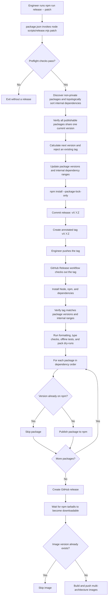

# Release flow

This traces the default `npm run release -- <version>` path from a clean checkout to published npm packages and container images. It reflects `scripts/release.mjs`, `.github/workflows/release.yml`, and the root `package.json` as of this change.

## Failure cases

| Failure | What would be visible | Why it stops or remains recoverable |
| --- | --- | --- |
| The working tree is dirty before the version bump. | The local command exits with `release: the working tree is dirty — commit or stash first`; no package manifests, commit, or tag are created. | `release.mjs` checks `git status --porcelain` before writing files, preventing unrelated changes from entering the release commit. |
| A tag does not match the package versions or an internal dependency range. | The workflow fails at **The tag must match the versions in the tree** with a message naming the mismatched package or dependency. No publish step runs. | Verification happens before tests, packing, or publishing, so the inconsistent tag cannot reach npm. |
| Publishing succeeds for some packages and then a later package fails. | The **Publish to npm** log shows earlier `npm publish` commands succeeding and the failing package's npm error; the GitHub release and image jobs do not complete. | A rerun is safe: the loop checks `npm view name@version`, prints `already published` for completed packages, and resumes in dependency order at the first missing package. |

## Scope

This documents the normal tagged release and the observable behavior of three failure modes. It does not model manual publishing, first publication of a new npm package, `workflow_dispatch`, or every image-build failure branch; those paths do not change the main route from the release command to a published package.
