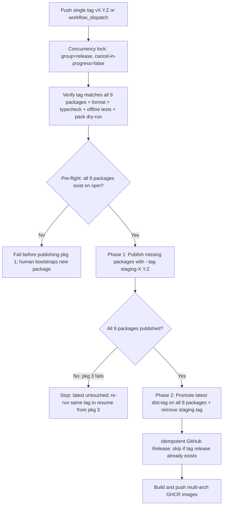

# Hardening Lockstep Releases Against Partial Failure

## Context & Current Pipeline Audit

`scripts/release.mjs` discovers and publishes **9 lockstep workspaces** in topological dependency order:

```text
packages/sandbox -> packages/neo -> packages/engine -> packages/server -> packages/view -> packages/cli -> packages/rag -> packages/gym -> packages/meta
```

`.github/workflows/release.yml` already gets several fundamentals right:

- `concurrency: { group: release, cancel-in-progress: false }` serializes runs so two tags do not race on npm packuments (`409 Failed to save packument`).
- `scripts/release.mjs verify <tag>` confirms every workspace version and internal `^x.y.z` range matches the tag before publishing.
- The publish loop checks `npm view "$name@$version" version` before calling `npm publish`, allowing re-runs to skip already-published packages.
- The `images` job waits for CDN `.tgz` availability (`curl -fsSLI`) and skips images already pushed to GHCR.

However, four concrete partial-failure gaps remain when packages 1 and 2 succeed and package 3 fails:

1. **Half-published `latest` exposure:** `npm publish` writes directly to the `latest` dist-tag per package. If `@zenera/sandbox` and `@zenera/neo` succeed and `@zenera/engine` fails (transient npm 5xx, rate limit, or `ENEEDAUTH`), `latest` is split across two versions until someone notices and re-runs.
2. **Late `ENEEDAUTH` on un-bootstrapped packages:** New packages lack an OIDC trusted publisher until their first version exists on npm. Without a pre-flight check, CI publishes packages `1..N-1` before crashing on package `N`.
3. **Non-idempotent GitHub Release step:** `gh release create "$TAG"` exits non-zero (HTTP 422) when a tag is re-dispatched after the `publish` job previously completed (for example, to retry a failed `images` job).
4. **Concurrency queue limit for rapid multi-tag pushes:** GitHub Actions concurrency keeps at most **one** queued run per group. Pushing 3+ tags at once silently drops middle runs even with `cancel-in-progress: false`.

---

## Target Release Design



### 1. Safe to Re-Run (Two-Phase Stage-Then-Promote)

- **Phase 1 (Stage):** Publish each missing package in dependency order with `--tag "staging-$VERSION"`. Already-published `name@version` entries are skipped.
- **Phase 2 (Promote):** Only after the entire loop completes without error, point `latest` to `name@version` for every workspace (`npm dist-tag add "$name@$version" latest`) and clean up the temporary staging tag.
- **Idempotent GitHub Release:** Check `gh release view "$TAG"` before calling `gh release create`.

If package 3 fails, packages 1 and 2 exist on npm under `staging-X.Y.Z`, **`latest` remains completely intact at the previous release**, and re-running the workflow with the same tag resumes cleanly at package 3.

### 2. Preventing Two Tags From Publishing at Once

- **Server-side:** Keep `concurrency: { group: release, cancel-in-progress: false }`.
- **Client-side / habit:** Push only the single intended tag (`git push origin main vX.Y.Z`, matching `Makefile`'s `make patch`) instead of `git push --follow-tags` when multiple local tags may exist.
- **Why not rely on `concurrency` alone:** GitHub Actions drops queued runs beyond depth 1; pushing one tag per release prevents silent drops.

### 3. Failure Cases Considered

| Failure Case                                                | What Happens Today                                                        | Behavior Under New Design                                                             |
| ----------------------------------------------------------- | ------------------------------------------------------------------------- | ------------------------------------------------------------------------------------- |
| Package 3 of 9 fails (npm 5xx / timeout)                    | Packages 1–2 live on `latest`; 3–9 missing                                | Packages 1–2 only on `staging-X.Y.Z`; `latest` unchanged; re-run resumes at pkg 3     |
| New package lacks npm OIDC trusted publisher                | Packages ahead of it publish to `latest`; fails mid-loop with `ENEEDAUTH` | Pre-flight `npm view "$name" name` fails **before** publishing package 1              |
| Workflow re-run after `publish` succeeded (`images` failed) | `gh release create` crashes with HTTP 422                                 | `gh release view` detects existing release and skips cleanly                          |
| Two tags pushed together                                    | Serialized by `concurrency: release`                                      | Serialized; pushing explicit single tag avoids GitHub Actions >1 queue drop           |
| Broken version discovered after promotion to `latest`       | Manual patch only; users keep pulling broken `latest`                     | Roll `latest` dist-tag back across all 9 packages + deprecate bad version + cut patch |
| CDN tarball lag after publish                               | `images` job polls `dist.tarball` via `curl -fsSLI`                       | Kept as-is (already resilient up to 20 min)                                           |
| Floating `npm@latest` breaks OIDC                           | `npm i -g npm@latest` can regress mid-release                             | Recommended follow-up: pin npm version or use Node 24's bundled npm (`11.x`)          |

### 4. Automatic vs. Human-in-the-Loop

| Action                                                          | Owner              | Rationale                                                                             |
| --------------------------------------------------------------- | ------------------ | ------------------------------------------------------------------------------------- |
| Lockstep verification, tests, pack dry-run                      | **Automatic (CI)** | Deterministic gate before any registry write                                          |
| Pre-flight check that all 9 packages exist on npm               | **Automatic (CI)** | Prevents mid-loop `ENEEDAUTH` partial publishes                                       |
| Staging publish, skip-if-published, atomic `latest` promotion   | **Automatic (CI)** | Safe, idempotent recovery on transient errors                                         |
| Idempotent GitHub Release & GHCR image push                     | **Automatic (CI)** | Safe to re-run without 422 or duplicate builds                                        |
| Bootstrapping a brand-new package's first version + OIDC config | **Human**          | Requires npm 2FA and npmjs.com Trusted Publisher setup                                |
| Deciding to roll back `latest` or deprecate a bad version       | **Human**          | Determining whether a bug warrants rollback vs. fast patch requires product judgement |
| Emergency `npm unpublish` (< 72 hours)                          | **Human**          | Destructive; breaks lockfiles and permanently burns the version string                |

### 5. Rule for Taking a Bad Version Back

1. **Failed before `latest` promotion (half-published on `staging-X.Y.Z`):**
    - Do **not** delete or move the git tag.
    - If the cause was transient (network/npm outage), re-run the workflow for the same tag.
    - If the code itself is bad, leave the staging versions unpromoted, deprecate any published staging packages (`npm deprecate <pkg>@<bad> "Unfinished release; do not use"`), and cut the next patch (`vX.Y.(Z+1)`).
2. **Broken version already promoted to `latest`:**
    - **Step 1 (Immediate mitigation):** Point `latest` back to the last known good lockstep version across **all 9 packages**:
        ```bash
        for dir in $(node scripts/release.mjs workspaces --paths); do
          name=$(node -p "require('./$dir/package.json').name")
          npm dist-tag add "$name@<LAST_GOOD_VERSION>" latest
        done
        ```
    - **Step 2 (Warn pinned installs):** Deprecate the bad version across all 9 packages so anyone with a lockfile or explicit range sees a clear warning:
        ```bash
        for dir in $(node scripts/release.mjs workspaces --paths); do
          name=$(node -p "require('./$dir/package.json').name")
          npm deprecate "$name@<BAD_VERSION>" "Broken release; use <LAST_GOOD_VERSION> or upgrade to <NEXT_VERSION>"
        done
        ```
    - **Step 3 (Fix forward):** Ship a new patch release (`npm run release -- patch`).
3. **When (and only when) to `npm unpublish`:**
    - Only within npm's 72-hour window for a severe security vulnerability or leaked credential where zero external projects depend on the version. Never use `unpublish` for ordinary bugs.

---

## First Change Implemented Here

Implemented directly in `.github/workflows/release.yml`:

1. Added **Verify all packages exist on npm** pre-flight step before publishing package 1.
2. Changed **Publish to npm** to two-phase **stage-then-promote** (`--tag "staging-$version"` -> `npm dist-tag add ... latest` -> cleanup staging tag).
3. Made **GitHub release** idempotent via `gh release view "$TAG"` before `gh release create`.
