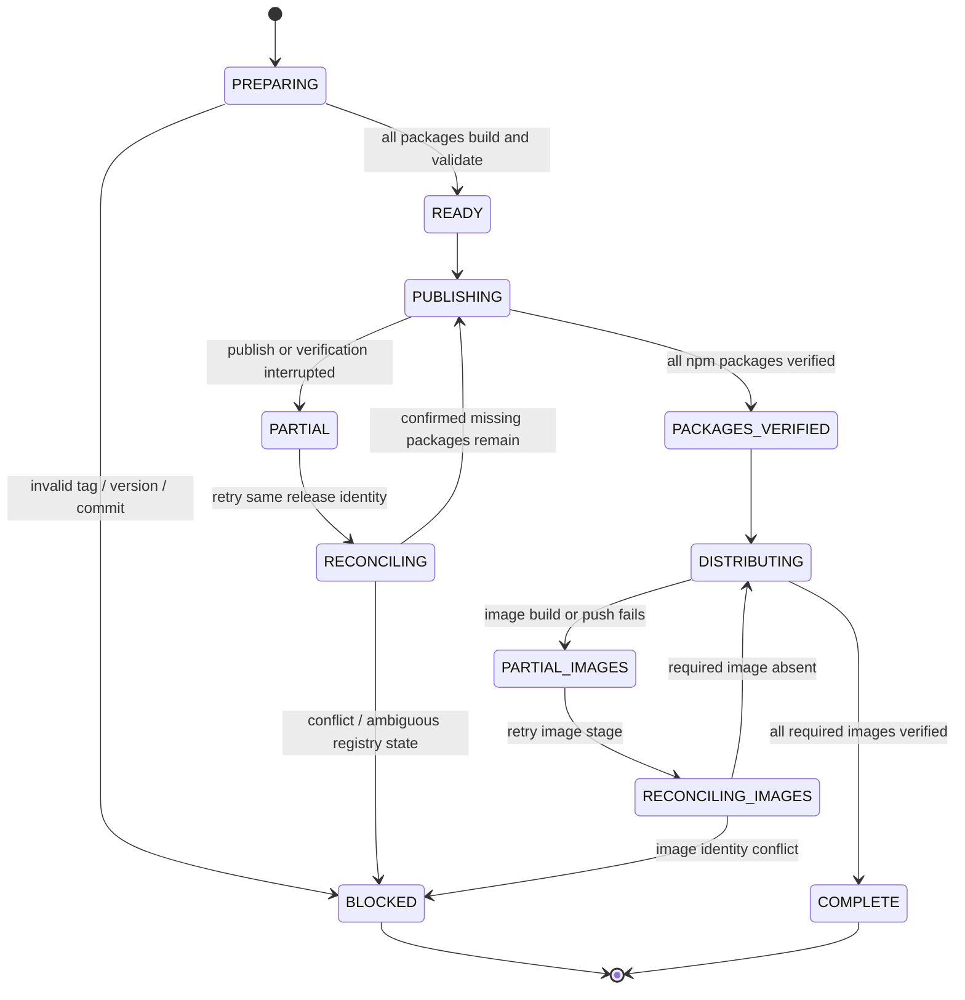

# Release state machine and manifest

## Design principles

1. **No multi-registry transaction is assumed.** npm and GHCR do not participate in one atomic commit. A partial release is a normal recoverable state.
2. **External registries are authoritative for artifact existence.** A manifest records intent and observations; it cannot make an absent package present or prove a package is correct by itself.
3. **Immutable identity.** A release is identified by repository, tag, and peeled source commit SHA. A tag resolving to another commit is a hard conflict, not a retry.
4. **Fail closed.** Only an explicit registry not-found response means an artifact is absent. Permission errors, throttling, timeouts, 5xx responses, malformed output, and DNS failures are not absence.
5. **Publish sequentially in dependency order.** Preserve the ordering already computed by `scripts/release.mjs`.
6. **Separate package and image completion.** Image failure must not trigger republishing npm packages.

## Lifecycle



## Manifest shape

The following is illustrative JSON. Store it as a CI artifact or durable release record; choose a persistence system with atomic updates and access controls before implementation.

```json
{
    "schemaVersion": 1,
    "repository": "zenera-ai/ZeneraNeo",
    "tag": "vX.Y.Z",
    "version": "X.Y.Z",
    "sourceCommit": "<peeled-tag-commit-sha>",
    "status": "PARTIAL",
    "createdAt": "<ISO-8601-UTC>",
    "updatedAt": "<ISO-8601-UTC>",
    "packages": [
        {
            "name": "@zenera/neo",
            "version": "X.Y.Z",
            "directory": "packages/neo",
            "status": "VERIFIED",
            "registryDistSha256": "<integrity-or-dist-verification-value>",
            "attempts": 1,
            "lastObservedAt": "<ISO-8601-UTC>"
        }
    ],
    "images": [
        {
            "name": "ghcr.io/zenera-ai/zenera-agent-runtime",
            "tag": "X.Y.Z",
            "platforms": ["linux/amd64", "linux/arm64"],
            "status": "PENDING",
            "digest": null,
            "attempts": 0
        }
    ],
    "attemptHistory": []
}
```

Use explicit package statuses:

- `PENDING`: not yet attempted.
- `PUBLISHING`: publish request started; outcome may be unknown after interruption.
- `PUBLISHED_UNVERIFIED`: publish command returned success, but registry visibility or metadata check is incomplete.
- `VERIFIED`: exact expected package version is visible and metadata/integrity matches the release build record.
- `BLOCKED`: observed conflict needs an operator.

Use explicit image statuses:

- `PENDING`, `BUILDING`, `PUSHED_UNVERIFIED`, `VERIFIED`, `BLOCKED`.

Top-level statuses should be derived from child states, not updated independently by hand. `COMPLETE` is valid only if every required child is `VERIFIED` and the GitHub Release entry is present and tied to the same tag.

## Idempotent reconciliation algorithm

For each package in dependency order:

1. Query `npm view <name>@<version> version --json` with a bounded timeout.
2. If found, fetch the package metadata and compare version, expected package identity, and any available integrity/provenance evidence. Mark `VERIFIED` only after comparison.
3. If and only if the registry clearly reports that exact version does not exist, publish the already-built tarball for this package.
4. After a successful publish response, poll for registry visibility with bounded exponential backoff and jitter. Record each observation.
5. If the publish request timed out or returned an ambiguous response, do not publish again immediately. Query the exact version until the outcome is resolved or the run is marked `BLOCKED` for operator review.
6. If a version exists but its metadata does not match the release record, stop. Never attempt to overwrite or silently skip it.

Build tarballs once before publishing and retain them as workflow artifacts with SHA-256 hashes. Publishing those exact tarballs prevents a retry from rebuilding different bytes under the same version. A build can be repeated before the first publish, but after any package version is published the release artifact set must be frozen.

## Concurrency and locking

The existing GitHub Actions `concurrency.group: release` is a useful first layer, but a stronger design should:

- Use one static repository-scoped group for all release entry points, including tag pushes and manual dispatch.
- Set `cancel-in-progress: false`.
- Do not treat the Actions concurrency group as a durable mutex or assume it controls external/manual publishers.
- If releases may be launched outside the single GitHub workflow, acquire a lease in a durable store (for example, a GitHub deployment/environment gate or an external lock service). The lock record should include owner/run ID, release identity, acquisition time, heartbeat/lease expiry, and a fencing token.
- Re-check tag-to-commit identity and release status after acquiring the lock.
- Require the lock for manual recovery as well as initial publication.

A lease needs an expiry/heartbeat and fencing token so a stale runner cannot resume side effects after its lease has been replaced. GitHub Actions concurrency alone does not provide this fencing property.

## Atomicity boundary

The package set cannot be made atomic across npm publications. The achievable guarantee is **at-least-once orchestration with idempotent, externally reconciled side effects**, not exactly-once distributed transactions. For immutable version publication, the registry's uniqueness constraint plus preflight/reconciliation gives effectively-once outcomes when conflicts are handled safely.
