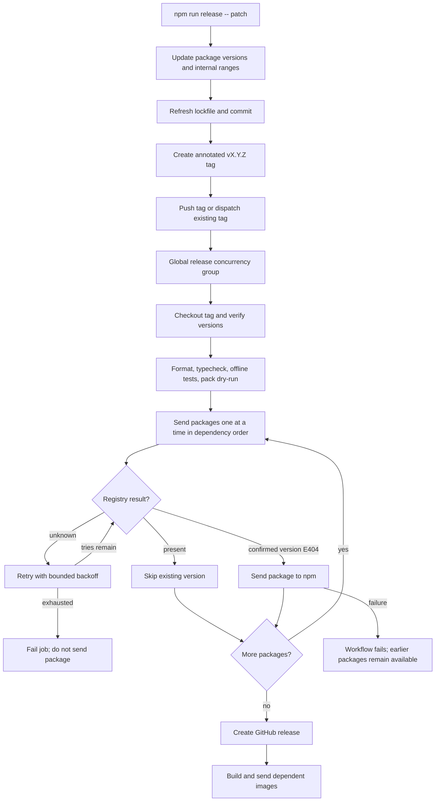

# Release recovery design

**Scope:** repository review and release design only. `npm install` downloaded dependencies from npm. No package was published, and no GitHub release, image, or remote tag was created. The deliberate registry lookups used empty user/global npm config; no token was read.

## Current release path

`npm run release -- patch` (or `minor`, `major`, or an explicit version) updates every publishable workspace to one version, refreshes the lockfile, commits, and creates the `vX.Y.Z` tag. Pushing the tag starts the Release workflow. The workflow verifies the tag against all package versions, checks formatting/types/tests and packability, then sends packages sequentially in dependency order. It skips a package version found in npm. After all packages are sent, it creates a GitHub release; dependent image jobs then build/push images.

Validate with `npm run mermcheck` from the repository root.

## Evidence from the current repository

- `package.json:23` enables `.githooks`; `package.json:38-40` defines release, check, and package scripts.
- `scripts/release.mjs:38-60` derives dependency order and includes non-private packages. `scripts/release.mjs:81-110` verifies that the tag, package versions, and internal dependency ranges agree.
- `scripts/release.mjs:113-149` rejects dirty trees and existing tags, synchronizes versions and internal ranges, commits, creates the tag, and prints the push instruction. This means the Git tag exists before registry publication starts.
- `.github/workflows/release.yml:6-13` starts on version tags or manual dispatch of an existing tag. `:18-22` sets the shared `release` concurrency group with cancellation disabled.
- `.github/workflows/release.yml:32-55` checks out the tag, verifies it, and runs formatting, typecheck, offline tests, and a pack dry-run before the package loop.
- `.github/workflows/release.yml:60-82` loops through workspaces sequentially; the registry lookup module skips a present version, proceeds only on a confirmed missing-version E404, and fails closed for other outcomes.
- `scripts/registry-lookup.mjs` classifies npm's JSON result and retries unknown responses three times with exponential delays. `packages/cli/test/registry-lookup.test.ts` tests classification and retry behavior without network access.
- `.github/workflows/release.yml:80-84` creates the GitHub release after the package loop. `:94-175` runs image jobs only after the package job succeeds, waits for tarballs, and skips images that already exist.

## Failure cases

| Failure                                                   | What is visible                                                                                   | State left behind                                                                                                                             |
| --------------------------------------------------------- | ------------------------------------------------------------------------------------------------- | --------------------------------------------------------------------------------------------------------------------------------------------- |
| Version/lockstep/tag validation or preflight check fails  | Failed workflow before package publication                                                        | Git commit and tag may exist; npm packages unchanged                                                                                          |
| Registry/network/auth error during lookup                 | The lookup retries unknown outcomes three times and exits with status 1                           | Workflow fails before sending that package; prior packages remain available                                                                   |
| E404 for an unknown package name                          | E404 summary does not match the missing-version form; it is treated as unknown                    | Lookup retries and then fails closed; no package is sent                                                                                      |
| Package N send fails after earlier packages succeeded     | Failed package step; preceding package versions remain in npm                                     | Tag exists; some packages at this version (and potentially `latest`), later packages absent; no GitHub release or images                      |
| Workflow is re-run after partial publication              | Existing versions are logged as skipped; remaining versions are attempted                         | Can complete if registry lookup is accurate and the absent versions remain available                                                          |
| Two version tags arrive close together                    | Runs share `group: release`, so they do not execute concurrently                                  | One active and at most one pending run; GitHub may replace an older pending run with a newer one, so queueing is not a durable release ledger |
| Bad package version is already published                  | Registry version cannot be overwritten; tag/release may already exist if all package steps passed | Consumers may have installed it; removing an npm version is not a safe rollback mechanism                                                     |
| Package step succeeds but GitHub release/image step fails | Package job or dependent image job reports failure                                                | npm packages stay published; GitHub release or some images may be missing; rerun can skip packages and images already present                 |

The registry lookup makes retry idempotent for a package name/version that is visible in npm. The implementation distinguishes npm's observed missing-version summary (`No match found for version …`) from an E404 for a missing package (`Not Found - GET …`). This depends on npm's current JSON error shape; unrecognized E404 shapes fail closed.

## Proposed operating rule

Keep the current lockstep version and annotated Git tag as the release identity. Keep one global release concurrency group, sequential dependency order, preflight checks, and per-package registry lookup. A retry must use the same tag; never bump a new version merely to get past a partial release. The implemented lookup treats only the confirmed missing-version response as permission to proceed, retries unknown responses three times with exponential delays, then fails closed. If the version exists, it is skipped; integrity comparison against the artifact built from the tagged tree remains a proposed follow-up guard.

The tag can remain the release intent marker created before package publication; the GitHub Release and images remain completion outputs after all package versions are available. This avoids pretending a Git tag can be atomically created after several irreversible registry writes. Keep the single lock across tag-triggered and manual runs, and make pending-run replacement visible to operators.

For a confirmed bad release, do not unpublish or reuse the version. A release owner should:

1. Stop further rollout and record the affected package versions.
2. Mark each bad version deprecated with a clear reason using `npm deprecate`.
3. Move the affected package `latest` dist-tag back to the last known-good version with `npm dist-tag add <package>@<known-good> latest` (and align any other public channel tags that were moved).
4. Correct the source and send the fix as a new lockstep version. Confirm consumers are no longer directed to the bad version.

Deprecation warns users who install the bad version; moving a dist-tag redirects unpinned installs, but neither reverses installs already made nor changes explicit version pins. A human release owner must decide the known-good target and communicate impact.

## Automatic vs. human

**Automatic:** tag/version validation; formatting, types, offline tests, package dry-run; global workflow serialization; dependency-ordered package sends; skip versions already present; stop on package errors; create GitHub release and then build images only after package publication completes.

**Human:** choose and approve the release version/tag; inspect a failed run and decide whether a retry is safe; investigate a registry query/integrity mismatch; decide whether a published version is defective; choose the rollback target and deprecation wording; confirm downstream impact and announce recovery.

## Implemented change

`.github/workflows/release.yml` now calls `scripts/registry-lookup.mjs`. Exit 0 means present and skips; exit 10 means a confirmed missing version and permits the package send; exit 1 means unknown after three attempts and fails the job. No dependencies were added, and the rest of the workflow is unchanged.

## Local evidence and limits

- `npm install` completed and configured `core.hooksPath` as `.githooks`.
- `node scripts/release.mjs workspaces --paths` listed nine publishable packages in the script's dependency order.
- `node scripts/release.mjs patch --dry-run` printed the proposed `1.3.19 -> 1.3.20` changes and restored the package manifests; it made no release commit or tag.
- With empty user/global npm config and the public registry, `npm view --json is-number@999.999.999 version` returned exit 1 with JSON `error.code: E404` and summary `No match found for version 999.999.999`.
- Under the same isolated config, `npm view --json @zenera/definitely-not-a-real-package-20261123 version` returned exit 1 with JSON `error.code: E404` and a `Not Found - GET …` summary. This verifies the two observed shapes with npm 11.19.0; it does not guarantee every npm CLI version/registry uses identical summaries.
- With the same empty npm config, `node scripts/registry-lookup.mjs is-number 7.0.0` printed `present` and exited 0; the `999.999.999` query printed `absent` and exited 10.
- `npx vitest run packages/cli/test/registry-lookup.test.ts` — 1 test file passed, 15 tests passed. Covered present, missing-version E404, missing-package E404, E401/E403/E429, ETIMEDOUT/ECONNRESET/E500/E503, plain crash diagnostics, empty/garbage output, retry then success, exhausted retries, and no retry for confirmed absence.
- `npx prettier --check scripts/registry-lookup.mjs packages/cli/test/registry-lookup.test.ts reports/release-safe-rerun/README.md .github/workflows/release.yml` — passed.
- `npm run mermcheck` — `18 diagram(s) in 118 file(s), 0 broken`.
- `npm run typecheck` — passed.
- `npm test -- --exclude '**/live-*'` — stopped because `.env` is absent. The workflow-equivalent offline runner, `npx vitest run --exclude '**/live-*'`, passed 119 files and 2,412 tests; 1 test was skipped.
- A local half-way package simulation was not run: the local command safety gate blocked a command that included the real workflow's package-send invocation, even though it was intended to use a temporary fake npm executable and no registry. No workaround was attempted. Consequently retry behavior is established by inspection of the workflow loop, not by a simulated run.
- No npm token was read or configured. No package was published, no tag was pushed, and no GitHub release or image was created.
- Still unverified: a real GitHub Actions run of this changed workflow; actual 401/403/429, network, and 5xx npm CLI outputs; registry integrity comparison; and interactions with npm provenance/OIDC in a live release.
