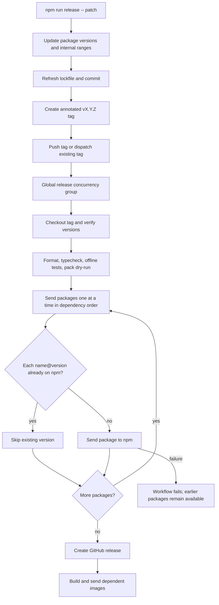

# Release recovery design

**Scope:** repository review and release design only. `npm install` downloaded dependencies from npm; no package was sent to npm, and no GitHub release, image, remote tag, or credential was used.

## Current release path

`npm run release -- patch` (or `minor`, `major`, or an explicit version) updates every publishable workspace to one version, refreshes the lockfile, commits, and creates the `vX.Y.Z` tag. Pushing the tag starts the Release workflow. The workflow verifies the tag against all package versions, checks formatting/types/tests and packability, then sends packages sequentially in dependency order. It skips a package version found in npm. After all packages are sent, it creates a GitHub release; dependent image jobs then build/push images.

Validate with `npm run mermcheck` from the repository root.

## Evidence from the current repository

- `package.json:23` enables `.githooks`; `package.json:38-40` defines release, check, and package scripts.
- `scripts/release.mjs:38-60` derives dependency order and includes non-private packages. `scripts/release.mjs:81-110` verifies that the tag, package versions, and internal dependency ranges agree.
- `scripts/release.mjs:113-149` rejects dirty trees and existing tags, synchronizes versions and internal ranges, commits, creates the tag, and prints the push instruction. This means the Git tag exists before registry publication starts.
- `.github/workflows/release.yml:6-13` starts on version tags or manual dispatch of an existing tag. `:18-22` sets the shared `release` concurrency group with cancellation disabled.
- `.github/workflows/release.yml:32-55` checks out the tag, verifies it, and runs formatting, typecheck, offline tests, and a pack dry-run before the package loop.
- `.github/workflows/release.yml:60-78` loops through workspaces sequentially; `npm view name@version` skips versions already visible in npm, and otherwise runs `npm publish`.
- `.github/workflows/release.yml:80-84` creates the GitHub release after the package loop. `:94-175` runs image jobs only after the package job succeeds, waits for tarballs, and skips images that already exist.

## Failure cases

| Failure                                                   | What is visible                                                                                   | State left behind                                                                                                                             |
| --------------------------------------------------------- | ------------------------------------------------------------------------------------------------- | --------------------------------------------------------------------------------------------------------------------------------------------- |
| Version/lockstep/tag validation or preflight check fails  | Failed workflow before package publication                                                        | Git commit and tag may exist; npm packages unchanged                                                                                          |
| Registry/network/auth error during `npm view`             | Current shell treats any nonzero query as “not found”; package send is attempted                  | The query error is not distinguished from absence; package operation can also fail                                                            |
| Package N send fails after earlier packages succeeded     | Failed package step; preceding package versions remain in npm                                     | Tag exists; some packages at this version (and potentially `latest`), later packages absent; no GitHub release or images                      |
| Workflow is re-run after partial publication              | Existing versions are logged as skipped; remaining versions are attempted                         | Can complete if registry lookup is accurate and the absent versions remain available                                                          |
| Two version tags arrive close together                    | Runs share `group: release`, so they do not execute concurrently                                  | One active and at most one pending run; GitHub may replace an older pending run with a newer one, so queueing is not a durable release ledger |
| Bad package version is already published                  | Registry version cannot be overwritten; tag/release may already exist if all package steps passed | Consumers may have installed it; removing an npm version is not a safe rollback mechanism                                                     |
| Package step succeeds but GitHub release/image step fails | Package job or dependent image job reports failure                                                | npm packages stay published; GitHub release or some images may be missing; rerun can skip packages and images already present                 |

The registry lookup currently makes retry idempotent for a package name/version that is visible in npm. It does not distinguish a definitive 404 from transient network, authorization, or registry failures; that is the first gap to close.

## Proposed operating rule

Keep the current lockstep version and annotated Git tag as the release identity. Keep one global release concurrency group, sequential dependency order, preflight checks, and per-package registry lookup. A retry must use the same tag; never bump a new version merely to get past a partial release. Before sending a package, treat only a confirmed “version absent” response as permission to proceed. Retry transient registry failures with bounded backoff, then fail closed with the package and query error visible. If the version exists, skip it; if its integrity does not match the artifact built from the tagged tree, stop and require a person rather than silently accepting it.

The tag can remain the release intent marker created before package publication; the GitHub Release and images remain completion outputs after all package versions are available. This avoids pretending a Git tag can be atomically created after several irreversible registry writes. Keep the single lock across tag-triggered and manual runs, and make pending-run replacement visible to operators.

For a confirmed bad release, do not unpublish or reuse the version. A release owner should:

1. Stop further rollout and record the affected package versions.
2. Mark each bad version deprecated with a clear reason using `npm deprecate`.
3. Move the affected package `latest` dist-tag back to the last known-good version with `npm dist-tag add <package>@<known-good> latest` (and align any other public channel tags that were moved).
4. Correct the source and send the fix as a new lockstep version. Confirm consumers are no longer directed to the bad version.

Deprecation warns users who install the bad version; moving a dist-tag redirects unpinned installs, but neither reverses installs already made nor changes explicit version pins. A human release owner must decide the known-good target and communicate impact.

## Automatic vs. human

**Automatic:** tag/version validation; formatting, types, offline tests, package dry-run; global workflow serialization; dependency-ordered package sends; skip versions already present; stop on package errors; create GitHub release and then build images only after package publication completes.

**Human:** choose and approve the release version/tag; inspect a failed run and decide whether a retry is safe; investigate a registry query/integrity mismatch; decide whether a published version is defective; choose the rollback target and deprecation wording; confirm downstream impact and announce recovery.

## The first change

Make the npm registry lookup fail closed: distinguish a confirmed not-found response from timeout, auth, rate-limit, and server errors. Retry only transient failures with bounded backoff; send a package only on confirmed absence; skip only on confirmed presence. This is a small workflow change that closes the concrete ambiguity in `.github/workflows/release.yml:71-75` without changing the existing tag or package model.

## Local evidence and limits

- `npm install` completed and configured `core.hooksPath` as `.githooks`.
- `node scripts/release.mjs workspaces --paths` listed nine publishable packages in the script's dependency order.
- `node scripts/release.mjs patch --dry-run` printed the proposed `1.3.19 -> 1.3.20` changes and restored the package manifests; it made no release commit or tag.
- `npm run mermcheck` was run after this report was written.
- A local half-way package simulation was not run: the local command safety gate blocked a command that included the real workflow's package-send invocation, even though it was intended to use a temporary fake npm executable and no registry. No workaround was attempted. Consequently retry behavior is established by inspection of the workflow loop, not by a simulated run.
- No npm token was read or configured. No package was sent to a registry, no tag was pushed, and no GitHub release or image was created.
